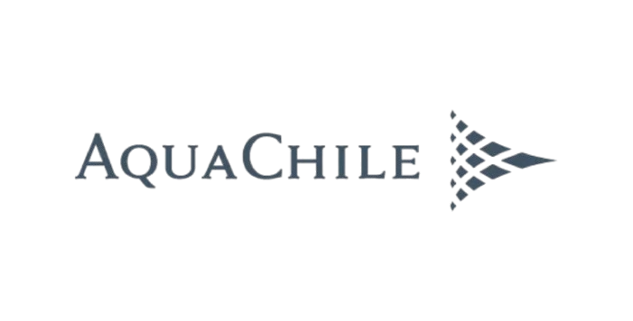
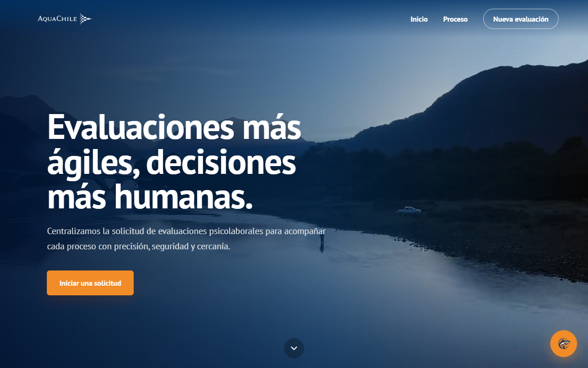
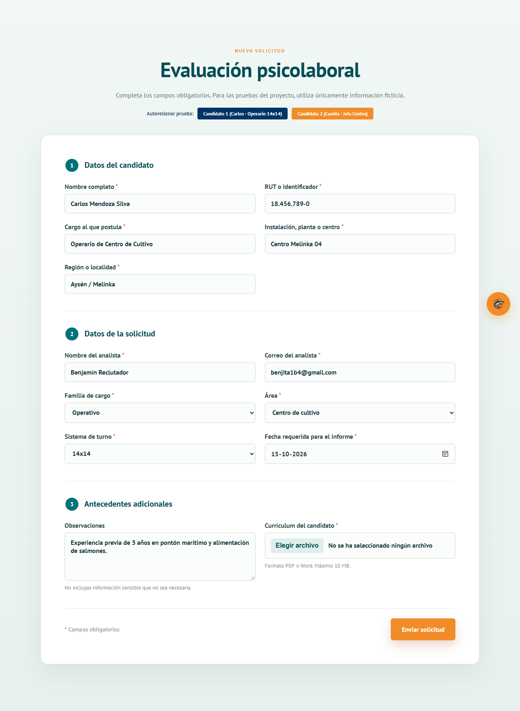
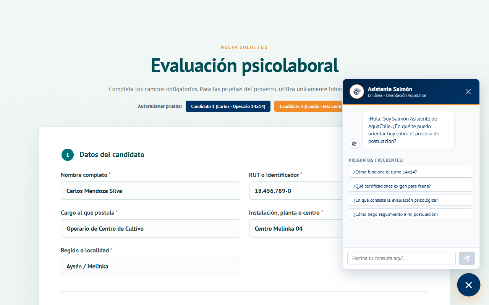
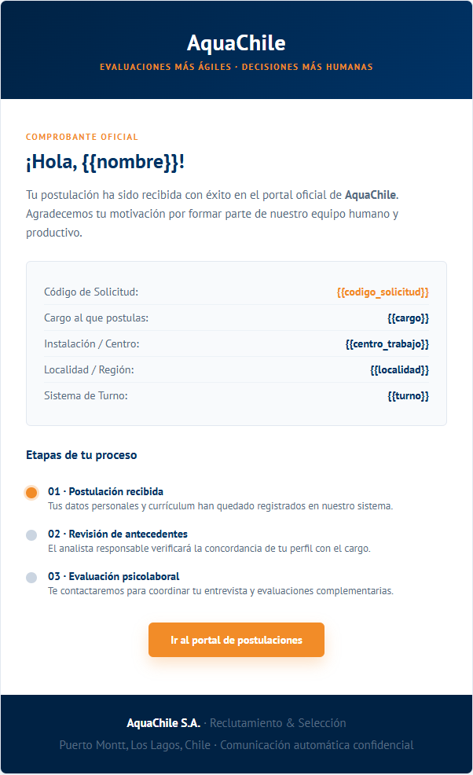

<div align="center">



# Plataforma de Gestión y Evaluación Psicolaboral — AquaChile

**Plataforma web para apoyar la recepción y gestión de solicitudes de evaluación psicolaboral.**


</div>

---

## Descripción

**AquaChile** reúne en una interfaz web los antecedentes necesarios para iniciar una evaluación psicolaboral de postulantes operativos y técnicos en centros de cultivo, pisciculturas y plantas de proceso. El proyecto incluye una página de presentación, un formulario de solicitud y un asistente virtual con información sobre el proceso.

## Funcionalidades

- Página de inicio con navegación, video e información del proceso.
- Formulario para registrar antecedentes del candidato, cargo, centro, localidad, turno, analista y fecha requerida.
- Validación del currículum en PDF o Word, con un tamaño máximo de 10 MB.
- Datos ficticios precargables para probar visualmente el formulario.
- Asistente Salmón con preguntas frecuentes y conexión opcional al servicio de chat.
- Plantillas HTML de notificación para candidato y analista.

## Vistas de la Plataforma

### 1. Portal de Inicio y Marca AquaChile

Portal público institucional con video de fondo, navegación corporativa y presentación de las etapas de postulación.



---

### 2. Formulario de Postulación de Candidatos

Captura de antecedentes personales, cargo, instalación (piscicultura/pontón), turno (ej. 14x14) y selección de currículum en PDF/Word. Incluye botones de prueba rápida para validación visual del flujo.



---

### 3. Asistente Salmón (Chatbot Flotante)

Asistente virtual en la esquina inferior derecha, con avatar animado, efecto máquina de escribir (*typewriter*) y preguntas frecuentes sobre turnos 14x14, certificaciones y etapas del proceso. Si el servicio del chatbot no está disponible, entrega una respuesta alternativa.



---

### 4. Notificaciones por Correo Electrónico (HTML)

El repositorio incluye plantillas HTML para los mensajes previstos en el flujo:

- **Candidato:** comprobante de postulación recibida con código de seguimiento y resumen de etapas.
- **Analista de Selección:** notificación con la ficha técnica del nuevo postulante y fecha límite requerida.




## Tecnologías y Arquitectura

- **Frontend:** React 19, Vite, CSS moderno responsivo, Google Fonts (`PT Sans`).
- **Diseño responsivo:** Bootstrap 5 y estilos propios con identidad AquaChile.
- **Backend incluido:** FastAPI / Python, con MongoDB Atlas o SQLite local.
- **Notificaciones:** el backend puede enviar confirmación HTML al candidato y aviso al analista con el CV adjunto mediante SMTP configurable.
- **Documentos:** carga y descarga autenticada de CVs mediante GridFS en MongoDB.
- **Asistente:** interfaz de preguntas frecuentes; el servicio de IA externo no forma parte de la API incluida.

### Organización del frontend

```text
src/
├── components/   # Componentes reutilizables que reciben props
├── data/         # Opciones y datos ficticios de la demostración
├── hooks/        # Comportamientos reutilizables de React
├── layouts/      # Estructuras pública e interna
├── pages/        # Pantallas asociadas a las rutas
├── services/     # Comunicación con la API
└── utils/        # Validaciones independientes del formulario
```

`PublicLayout` contiene el portal, la postulación y el asistente. `InternalLayout`
contiene el acceso del equipo y la gestión de evaluaciones. Los componentes
`FormField`, `FormStatus`, `SummaryCard`, `StatusBadge` y `ApplicationTable`
demuestran reutilización mediante propiedades, mientras que las páginas manejan
los estados de carga, éxito, error y datos de formulario.

---

## Equipo

- Benjamín Agüero
- Luis Fermín
- Raúl Ferrini

---

## Puesta en marcha local

El proyecto se configura con un archivo `.env` en la raíz del repositorio. Si no existe, créalo a partir de la plantilla:

Windows (PowerShell):
```powershell
Copy-Item .env.example .env
```

macOS / Linux:
```bash
cp .env.example .env
```

Para la demostración local usa `AQUACHILE_DB_MODE=sqlite` (no requiere Internet ni Atlas). Para MongoDB Atlas, completa `MONGODB_URI` y cambia a `AQUACHILE_DB_MODE=mongodb`.

### Requisitos
- Node.js 22.12 o superior
- Python (v3.10+)

### 1. Iniciar el Frontend
```bash
npm install
npm run dev
```
La aplicación abre en `http://localhost:5173/`. El frontend llama a `/api` en su mismo origen y Vite redirige esas peticiones al backend en `http://127.0.0.1:8001` (ver `vite.config.js`), así que no hace falta configurar CORS en desarrollo. Si el backend corre en otro puerto, define `VITE_API_PROXY_TARGET` en `.env`.

### 2. Iniciar el Backend & Servicios

Windows (PowerShell), desde la raíz del repositorio:
```powershell
python -m venv backend/.venv
backend/.venv/Scripts/python -m pip install -r backend/requirements.txt
backend/.venv/Scripts/python -m uvicorn api.app:app --app-dir backend --reload --port 8001
```

macOS / Linux, desde la raíz del repositorio:
```bash
python3 -m venv backend/.venv
source backend/.venv/bin/activate
pip install -r backend/requirements.txt
python -m uvicorn api.app:app --app-dir backend --reload --port 8001
```

API y documentación Swagger en: `http://127.0.0.1:8001/docs`

La configuración recomendada utiliza MongoDB Atlas. El modo SQLite se conserva
para que la demostración local funcione sin Internet. Consulta `backend/README.md`
para configurar la base de datos y el envío SMTP. Sin credenciales SMTP, las
postulaciones se guardan normalmente, pero no se envían correos.

### 3. Probar el flujo completo

1. Abre `http://localhost:5173/postulacion`, completa el formulario y adjunta un CV.
2. Entra a `http://localhost:5173/acceso-interno`.
3. Usa `rrhh@aquachile.demo` / `AquaChile2026`.
4. Revisa la postulación y registra el resultado de la evaluación.

### 4. Ejecutar pruebas frontend

```bash
npm test
npm run test:coverage
```

La suite incluye pruebas del layout compartido, navegación, formularios y validaciones con Vitest, React Testing Library y mocks de la API.
El alcance y los resultados esperados están documentados en
`docs/COBERTURA_TESTING.md`.

La API incluida usa MongoDB o SQLite.
