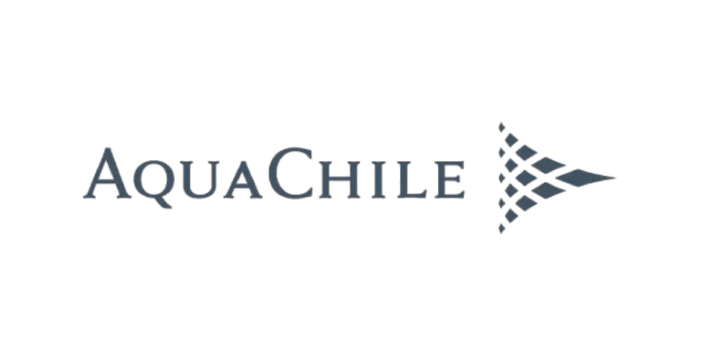
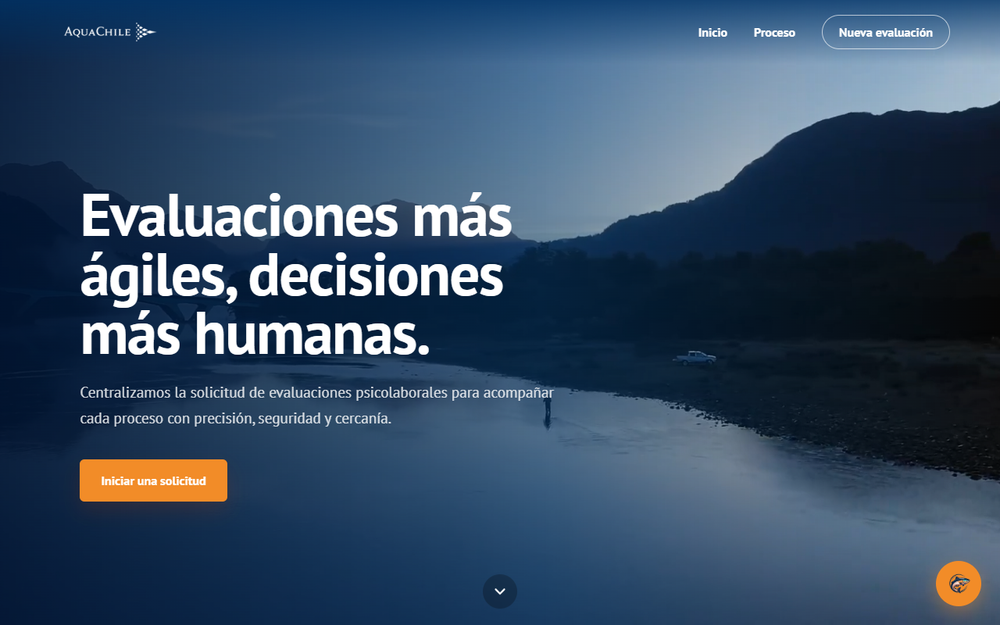
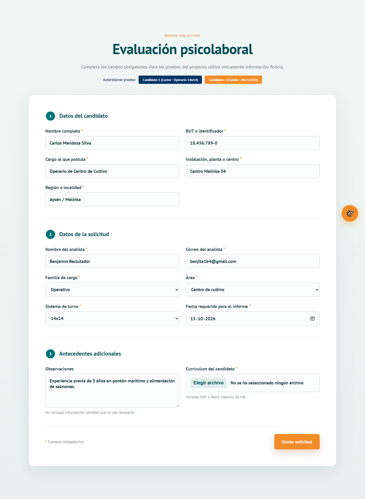
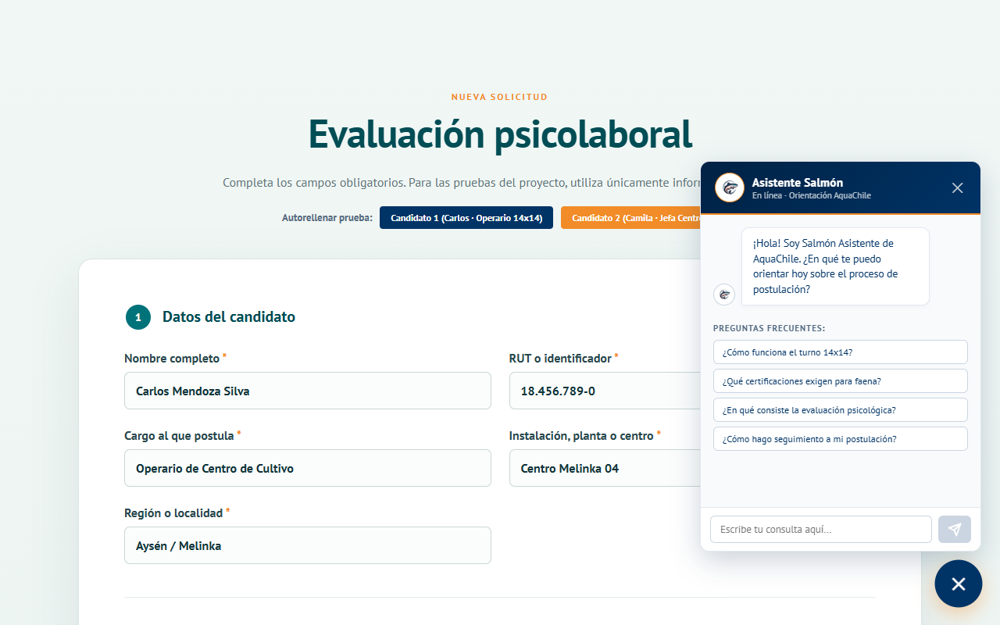
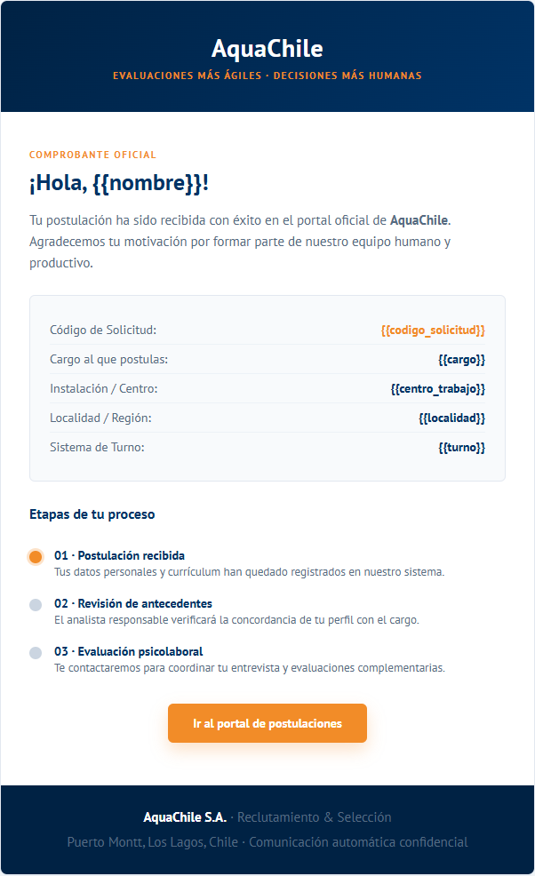

<div align="center">



# Plataforma de Gestión y Evaluación Psicolaboral — AquaChile

**Plataforma web para apoyar la recepción y gestión de solicitudes de evaluación psicolaboral.**


</div>

---

## Descripción

**AquaChile** reúne en una interfaz web los antecedentes necesarios para iniciar una evaluación psicolaboral de postulantes operativos y técnicos en centros de cultivo, pisciculturas y plantas de proceso. El proyecto incluye una página de presentación, un formulario de solicitud y un asistente virtual con información sobre el proceso.

## Funcionalidades

- Página de inicio con navegación, video e información del proceso.
- Formulario para registrar antecedentes del candidato, cargo, centro, localidad, turno, analista y fecha requerida.
- Validación del currículum en PDF o Word, con un tamaño máximo de 10 MB.
- Datos ficticios precargables para probar visualmente el formulario.
- Asistente Salmón con preguntas frecuentes y conexión opcional al servicio de chat.
- Plantillas HTML de notificación para candidato y analista.
- Scripts PL/SQL para el esquema de evaluación, auditoría y gestión de estados.

## Vistas de la Plataforma

### 1. Portal de Inicio y Marca AquaChile

Portal público institucional con video de fondo, navegación corporativa y presentación de las etapas de postulación.



---

### 2. Formulario de Postulación de Candidatos

Captura de antecedentes personales, cargo, instalación (piscicultura/pontón), turno (ej. 14x14) y selección de currículum en PDF/Word. Incluye botones de prueba rápida para validación visual del flujo.



---

### 3. Asistente Salmón (Chatbot Flotante)

Asistente virtual en la esquina inferior derecha, con avatar animado, efecto máquina de escribir (*typewriter*) y preguntas frecuentes sobre turnos 14x14, certificaciones y etapas del proceso. Si el servicio del chatbot no está disponible, entrega una respuesta alternativa.



---

### 4. Notificaciones por Correo Electrónico (HTML)

El repositorio incluye plantillas HTML para los mensajes previstos en el flujo:

- **Candidato:** comprobante de postulación recibida con código de seguimiento y resumen de etapas.
- **Analista de Selección:** notificación con la ficha técnica del nuevo postulante y fecha límite requerida.




## Tecnologías y Arquitectura

| Área | Tecnología |
| --- | --- |
| Interfaz | React, React DOM y Vite |
| Estilos | CSS responsivo y Google Fonts (`PT Sans`) |
| API y asistente | FastAPI / Python y Node.js Express según la arquitectura documentada; backend externo a este repositorio |
| Notificaciones | Plantillas HTML; el README original describe despacho SMTP desde Python |
| Base de datos | Oracle Database y PL/SQL en `database/` |
| Documentos | PDF de ejemplo en `cvs_ejemplo/`; el procesamiento automático requiere backend |

## Cómo ejecutar

### Requisitos

- **Node.js 18 o superior** y npm.
- Un navegador web actualizado.
- Para conectar las funciones del servidor, el backend FastAPI debe ejecutarse por separado en el puerto `8000` o debe actualizarse la URL en el frontend.
- Para instalar el módulo de base de datos: acceso a Oracle Database y SQL Developer, SQLcl o SQL*Plus.

### Opción A — Desarrollo local

Desde la carpeta raíz de este repositorio:

```bash
npm install
npm run dev
```

Vite mostrará en la terminal la dirección local, normalmente `http://localhost:5173/`.

Para generar una versión compilada del frontend:

```bash
npm run build
```

Los archivos generados quedan en `dist/`.

### Backend y servicios

El README original documenta un servicio FastAPI en `AquaChileAgente`, con esta forma de inicio:

```bash
cd AquaChileAgente
pip install -r requirements.txt
python -m uvicorn api.app:app --host 127.0.0.1 --port 8000 --reload
```

Ese directorio no está incluido en este repositorio. Si el backend está disponible por separado, inicia su API y revisa la documentación en `http://127.0.0.1:8000/docs`. El frontend actual usa `http://127.0.0.1:8000/api/postulante/formulario` para el formulario y `http://127.0.0.1:8000/api/chat/consulta` para el chat.

### Base de datos Oracle

Los scripts del módulo PL/SQL y su orden de ejecución están documentados en [`database/README.md`](database/README.md). Se ejecutan desde Oracle SQL Developer, SQLcl o SQL*Plus.

## Estructura del Proyecto

```text
.
├── assets/                    # Logos, imágenes y video de la página
├── cvs_ejemplo/               # CV ficticios para demostración
├── database/                  # Esquema, paquetes, triggers y pruebas PL/SQL
│   ├── packages/
│   ├── pruebas/
│   ├── schema/
│   └── triggers/
├── docs/screenshots/          # Capturas de las vistas y del correo
├── src/
│   ├── components/            # Componentes compartidos, incluido el chatbot
│   ├── hooks/                 # Hooks de interfaz
│   ├── layouts/               # Estructuras de página
│   ├── pages/                 # Vistas de inicio y postulación
│   ├── App.jsx                # Aplicación principal
│   ├── main.jsx               # Punto de entrada de React
│   └── styles.css             # Estilos globales
├── templates/                 # Plantillas HTML de correo
├── index.html
├── package.json
└── vite.config.js
```

## Equipo y Distribución de Roles

| Integrante | Rol Principal | Responsabilidades |
|---|---|---|
| **Benjamín Agüero**  | **Backend, IA & Notificaciones** | Arquitectura del servidor (FastAPI), despacho automatizado de correos corporativos HTML (SMTP), lógica del asistente interactivo e integración con el motor de evaluación psicolaboral. |
| **Luis Fermín**  | **Formularios, API & Persistencia** | Modelamiento de captura de antecedentes, validaciones de formularios de postulación interna/externa, endpoints de solicitudes y estructuración de base de datos relacional. |
| **Raúl Ferrini**  | **Frontend & UI/UX** | Diseño de interfaz en React + Vite con identidad visual de AquaChile, experiencia de usuario responsiva, integración de video corporativo y layout de vistas principales. |

## Tareas Pendientes y Próximos Pasos

- [ ] **Base de Datos Relacional:** Implementar el esquema relacional definitivo (PostgreSQL / Oracle) reemplazando la persistencia temporal en disco/memoria.
- [ ] **Bandeja de Gestión Interna (Dashboard RRHH):** Visualización tabular de candidatos con filtros avanzados por centro de cultivo, localidad, turno y analista asignado.
- [ ] **Pipeline de Estados:** Gestión del ciclo de vida del candidato (*Postulado → En Revisión → Citado → Evaluado → Apto/No Apto*).
- [ ] **Módulo Psicolaboral del Evaluador:** Conectar el pre-filtro de compatibilidad del CV con la cabina de entrevista del psicólogo.
- [ ] **Autenticación y Roles:** Control de acceso basado en roles (Candidato externo vs. Analista RRHH vs. Psicólogo evaluador).
- [ ] **Almacenamiento de Archivos en la Nube:** Migración de almacenamiento de CVs y grabaciones a un almacenamiento de objetos seguro (S3 / Azure Blob).

---

## Módulo de Base de Datos

El directorio `database/` contiene la implementación PL/SQL de Oracle Database para la lógica transaccional y la auditoría del ciclo de vida de postulaciones y evaluaciones. Incluye el trigger de auditoría, el paquete de gestión de evaluaciones, el esquema y casos de prueba. La descripción detallada se mantiene en [`database/README.md`](database/README.md).
